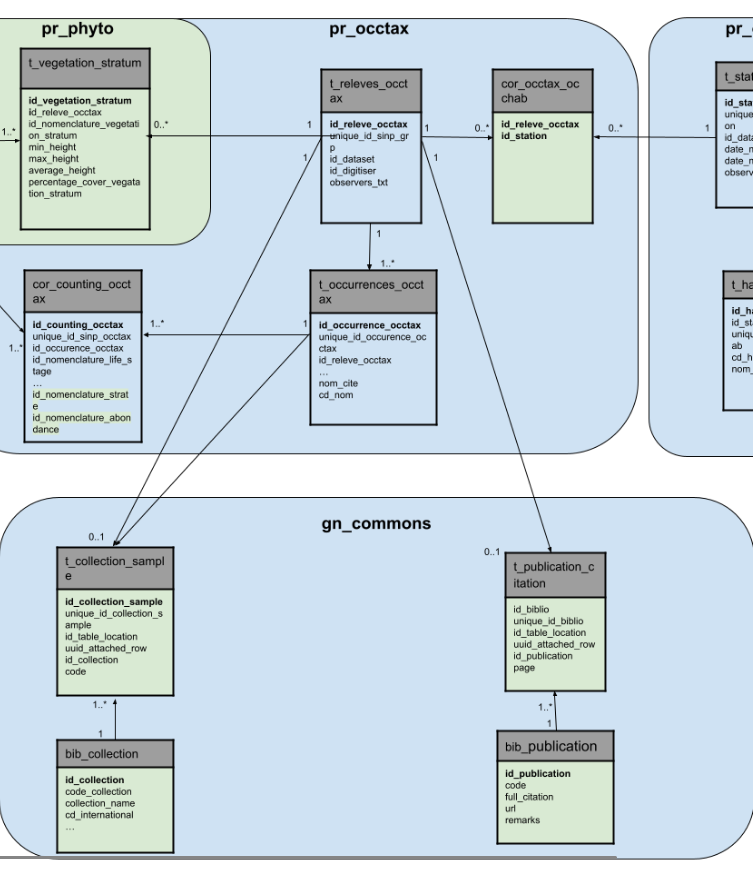
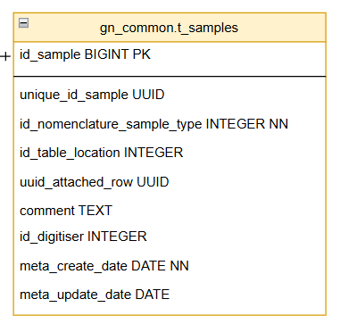
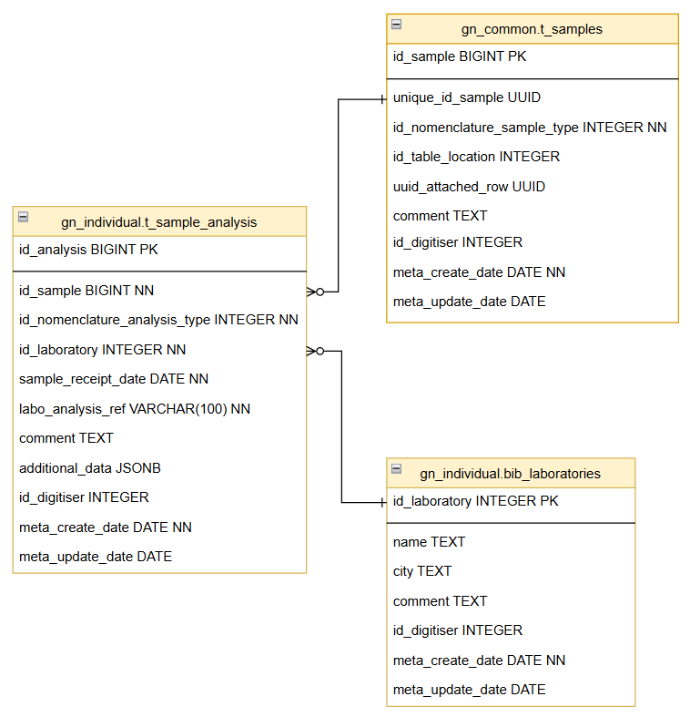
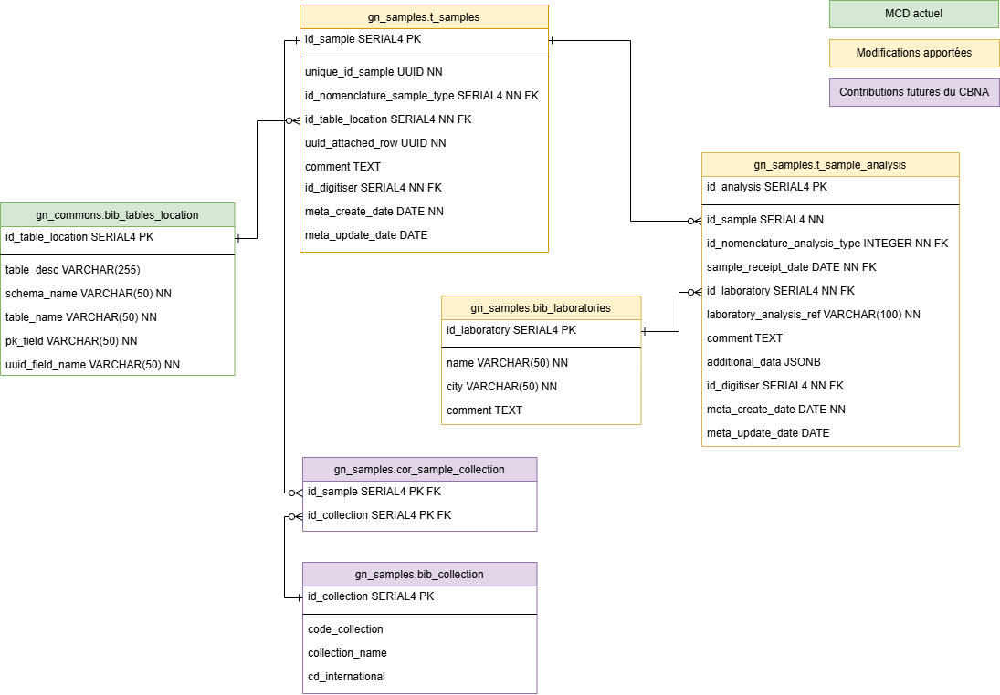
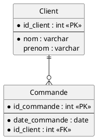

# Cahier des charges pour la gestion des échantillons dans GeoNature

> *Contexte : Projet européen Cross-DBio
> Autrice : Cynthia Borot - Parc National de la Vanoise*

- [Cahier des charges général : Solution de suivi et de gestion d’individus et d'échantillons](../../cahier-des-charges/Cross-DBio-CDC_individus-echantillons.md#cahier-des-charges-pour-une-solution-de-suivi-et-gestion-dindividus-et-gestion-déchantillons)
  - [Contexte et besoin](./../cahier-des-charges/Cross-DBio-CDC_individus-echantillons.md#contexte-et-besoin)
  - [Objectifs](./../cahier-des-charges/Cross-DBio-CDC_individus-echantillons.md#objectifs)
  - [Architecture](./../cahier-des-charges/Cross-DBio-CDC_individus-echantillons.md#architecture)
  - [Données concernées par le projet](./../cahier-des-charges/Cross-DBio-CDC_individus-echantillons.md#données-concernées-par-le-projet)

- [Cahier des charges pour la gestion des échantillons dans GeoNature](#cahier-des-charges-pour-la-gestion-des-échantillons-dans-geonature)
  - [Architecture](#architecture)
    - [Présentation générale](#présentation-générale)
    - [Modifications du coeur](#modifications-du-coeur)
    - [Création du module \`gn\_module\_samples\_managment](#création-du-module-gn_module_samples_managment)
  - [Modèle de données relationnel](#modèle-de-données-relationnel)
    - [Echantillons](#echantillons)
      - [`t_samples`](#t_samples)
    - [Analyse des échantillons](#analyse-des-échantillons)
      - [`t_samples_analysis`](#t_samples_analysis)
      - [`bib_laboratories`](#bib_laboratories)
    - [Modèle de données complet](#modèle-de-données-complet)
  - [Diagrammes de séquences](#diagrammes-de-séquences)
  - [Ajout d'une analyse](#ajout-dune-analyse)
  - [Modification d'une analyse](#modification-dune-analyse)

## Architecture

### Présentation générale

Dans un 1er temps, un module externe de gestion des échantillons `gn_module_samples` sera développé pour les mêmes raisons de simplification et d'efficacité que le module `gn_module_individuals`.

**Les choix fonctionnels** ont été pensés génériques afin que la communauté des utilisateurs de GeoNature puisse adopter ces nouvelles fonctionalités :

- Gestion (CRUED) d'échantillons
- Association de ces échantillons à une observation (relevé, occurence ou dénombrement)
- Gestion (CRUED) des analyses réalisées sur ces échantillons

Ce module sera imbriqué au projet de gestion des collections (herbiers ...) du CBNA, étroitement lié aux échantillons.

**Côté technique** :

- Un schéma de BDD spécifique `gn_samples` accuillera l'ensemble de ces données afin de ne pas alourdir le schéma `gn_commons`.
- Le frontend et le backend seront développés dans un module externe en réutilisant tant que faire ce peut les développements réalisés dans le coeur.
- Pour le backend, s'inspirer de `occhab`.
- Pour le frontend, il n'existe pas de recommendation.

### Modifications du coeur

> [!CAUTION]
> A faire

### Création du module `gn_module_samples_managment

> [!CAUTION]
> A faire

## Modèle de données relationnel

### Echantillons

Des échantillons peuvent être collectés sur le terrain dans différents contextes :

- Lors de la capture d'un individu (CMR), la prise d'échantillons est faite sous forme de prise de sang par exemple
- Lors de l'observation d'indices de présence sur le terrain, des échantillons peuvent être de même prélevés afin d'être analysés en laboratoire (génétique), le taxon n'est alors pas forcément connu
- Lors d'un relevé botanique et/ou entomologique, des échantillons peuvent être récoltés afin de réaliser la détermination des espèces au microscope.

Notre modèle doit satisfaire tout ces cas d'usage. A la lecture du travail porté par le CBNA (issue [#3603](https://github.com/PnX-SI/GeoNature/issues/3603)), nous repartirons de leurs réflexions pour implémenter notre besoin. Ce modèle permet d’associer un échantillon `gn_common.t_collection_sample` à tout type d'objet via les champs `id_table_location` et `uuid_attached_row`.

*Extrait du cahier des charges 'Relevés floristiques et phytosociologiques' du CBNA* :


  
Nous nommerons la table de stockage des échantillons `gn_common.t_samples` (et non `gn_common.t_collection_sample`) car son usage se fera au dela de la notion de collection. Cela sera convenu avec le CBNA

*Shéma de la table `gn_common.t_samples`* :



#### `t_samples`

Schéma : gn_sample
Table : t_samples

| Champs | Type | Contrainte | Détail |
| :---- | :---- | :---- | :---- |
| id_sample | BIGINT | PK, NOT NULL | Identifiant unique de l'échantillon |
| unique_id_sample | UUID | NOT NULL | Identifiant unique et universel de l'échantillon. Utilisé lors de transmission des données à d'autres établissement afin d'éviter les doublons. |
| id_nomenclature_sample_type | SERIAL4 | PK, NOT NULL | Identitifiant du type d'échantillon récolté (ex : cadavre, crottes, plantes, terre) lié au champ `id_nomenclature` de la table `ref_nomenclatures.t_nomenclatures` |
| id_table_location | INTEGER | FK | Identifiant de la table à laquelle est rattaché cet échantillon lié au champ `id_table_location`de la table `gn_commons.bib_table_location`. Cette méthode reprend ce qui a été fait pour la gestion des médias qui peuvent être associés à toute entrée d'une table disposant d'un uuid. |
| uuid_attached_row | UUID | - | Ce champ est étroitement lié à l'id_table_location. Cet uuid est celui de l'entrée de la table mentionnée via le id_location_table. |
| comment | TEXT | - | Commentaires |
| id_digitiser | SERIAL4 | FK, NOT NULL | Identifiant de la personne ayant saisi l'enregistrement, lié au champ `id_role` de la table `utilisateurs.t_roles` |
| meta_create_date | DATE | NOT NULL | Date de création de l'enregistrement |
| meta_update_date | DATE | - | Date de la dernière mise à jour de l'enregistrement |

### Analyse des échantillons

Aujourd'hui, au Parc national de la Vanoise, les résultats d'analyses sont, pour la plus part, compilés dans un fichier xsl. Dans d'autres structures, ces fiches sont très souvant classées sous forme papier et/ou numérisées en format pdf.

Le projet est de faciliter l'exploitation des données en enregistrant ces fiches dans une table unique dont la plupart des champs seront configurables via le champ json `additional_data` de la table `gn_sample.t_sample_analysis`.

La bibliothèque `gn_sample.bib_laboratories` permettra de stocker de façon propre les noms des laboratoires d'analyse.

*Shémas de liaison entre les tables `gn_common.t_samples`, `gn_sample.t_samples_analysis` et `gn_sample.bib_laboratories`* :



#### `t_samples_analysis`

Schéma : gn_sample
Table : t_samples_analysis

| Champs | Type | Contrainte | Détail |
| :---- | :---- | :---- | :---- |
| id_analysis | SERIAL4 | PK | Identifiant unique de l'analyse |
| id_sample | SERIAL4 | FK, NOT NULL | Identifiant de l'échantillon concerné par l'analyse pointant vers gn_commons.t_samples |
| id_nomenclature_analysis_type | SERIAL | FK, NOT NULL, CHECK | Identifiant du type d'analyse (ex : génétique, sérologie, ...) lié au champ `id_nomenclature` de la table `ref_nomenclatures.t_nomenclatures` |
| id_laboratory | SERIAL4 | FK, NOT NULL | Identifiant du la boratoire e ncharge de l'analyse lié au champs `id_laboratory` de la table `bib_laboratories` |
| sample_receipt_date | DATE | NOT NULL | Date de réception de l'échantillon au laboratoire |
| labo_analysis_ref | VARCHAR(100) | NOT NULL | Identifiant de l'analyse au seinb du laboratoire |
| comment | TEXT | - | Commentaires |
| additional_data | JSONB | - | Données non génériques associées à l'analyse : les résulstats d'analyse, très différents d'un type d'analyse à un autre seront stockés ici |
| id_digitiser | SERIAL4 | FK, NOT NULL | Identifiant de la personne ayant saisi l'enregistrement, lié au champ `id_role` de la table `utilisateurs.t_roles` |
| meta_create_date | DATE | NOT NULL | Date de création de l'enregistrement |
| meta_update_date | DATE | - | Date de la dernière mise à jour de l'enregistrement |

#### `bib_laboratories`

Schéma : gn_sample
Table : bib_laboratories

| Champs | Type | Contrainte | Détail |
| :---- | :---- | :---- | :---- |
| id_laboratory | SERIAL4 | PK | Identifiant unique du laboratoire |
| name | TEXT | NOT NULL | Nom complet du laboratoire |
| city | TEXT | NOT NULL | Nom de la ville où est implanté le laboratoire |
| comment | TEXT | - | Commentaires |
| id_digitiser | SERIAL4 | FK, NOT NULL | Identifiant de la personne ayant saisi l'enregistrement, lié au champ `id_role` de la table `utilisateurs.t_roles` |
| meta_create_date | DATE | NOT NULL | Date de création de l'enregistrement |
| meta_update_date | DATE | - | Date de la dernière mise à jour de l'enregistrement |

### Modèle de données complet

> [!CAUTION]
> Le modèle de données, ci-dessous, ne reprends pas l'ensemble du modèle de GeoNature. Il ne présente que les nouvelles tables créées pour la gestion des échantillons et des analyses ainsi que les tables principales du modèle actuel nécessaires à la compréhension. Les champs ajoutés aux tables existantes sont surlignés en orange.

*Schéma complet du MCD de gestion des échantillons* :



## Diagrammes de séquences

## Ajout d'une analyse

```plantuml
!include diagrams/diagramme-simple_ajout-analyse.uml 
```

## Modification d'une analyse

```plantuml
!include diagrams/diagramme-simple_modif-analyse.uml 
```

Exemple pour schéma bdd


