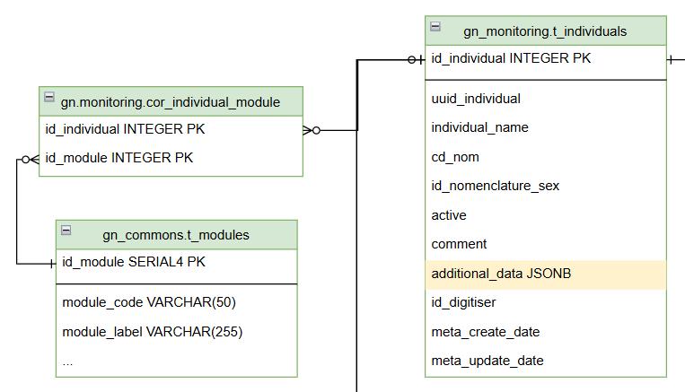
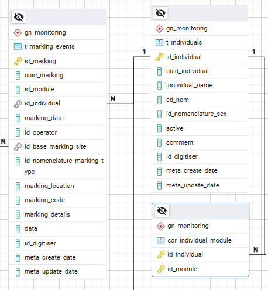
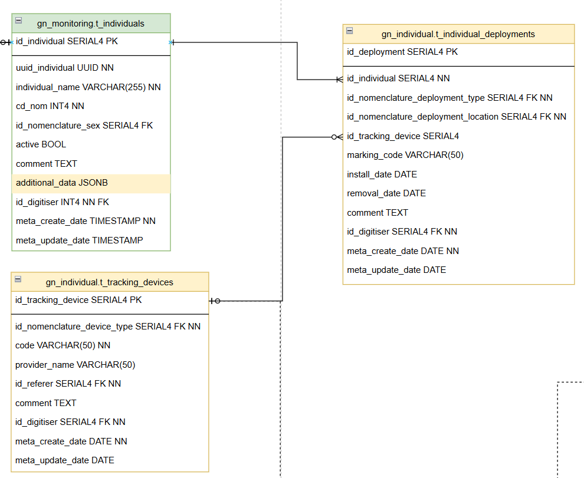
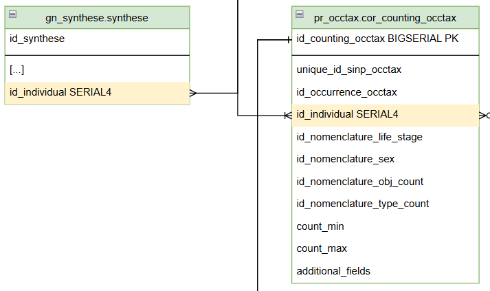
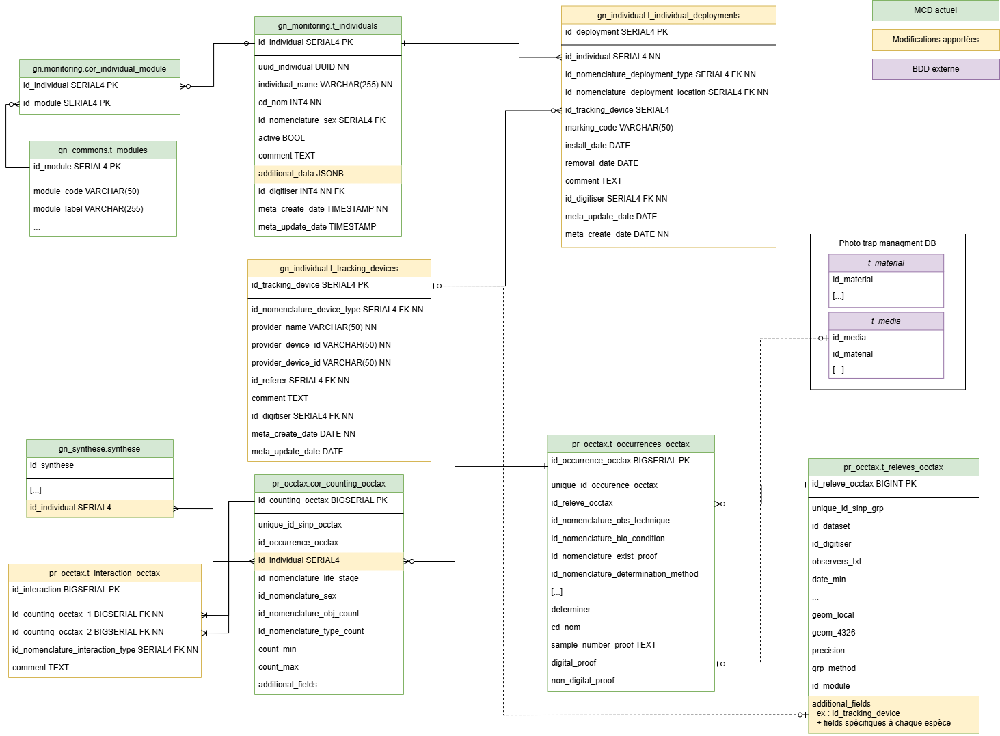

# Cahier des charges pour la gestion des individus dans GeoNature

> Contexte : Projet européen Cross-DBio
> Autrice : Cynthia Borot - Parc National de la Vanoise*

- [Cahier des charges général : Solution de suivi et de gestion d’individus et d'échantillons](../../cahier-des-charges/Cross-DBio-CDC_individus-echantillons.md#cahier-des-charges-pour-une-solution-de-suivi-et-gestion-dindividus-et-gestion-déchantillons)
  - [Contexte et besoin](./../cahier-des-charges/Cross-DBio-CDC_individus-echantillons.md#contexte-et-besoin)
  - [Objectifs](./../cahier-des-charges/Cross-DBio-CDC_individus-echantillons.md#objectifs)
  - [Architecture](./../cahier-des-charges/Cross-DBio-CDC_individus-echantillons.md#architecture)
  - [Données concernées par le projet](./../cahier-des-charges/Cross-DBio-CDC_individus-echantillons.md#données-concernées-par-le-projet)
..

- [Cahier des charges pour la gestion des individus dans GeoNature](#cahier-des-charges-pour-la-gestion-des-individus-dans-geonature)
  - [Architecture](#architecture)
    - [Présentation générale](#présentation-générale)
      - [Modifications du coeur](#modifications-du-coeur)
      - [Création du module `gn_module_individuals_managment`](#création-du-module-gn_module_individuals_managment)
  - [Modèle de données relationnel](#modèle-de-données-relationnel)
    - [Individus](#individus)
      - [`t_individuals`](#t_individuals)
      - [`cor_individual_module`](#cor_individual_module)
    - [Equipement des individus](#equipement-des-individus)
      - [`t_individual_deployments`](#t_individual_deployments)
      - [`t_tracking_devices`](#t_tracking_devices)
    - [Observations occasionnelles humaines d'un individu](#observations-occasionnelles-humaines-dun-individu)
      - [`pr_occtax.t_releves_occtax`](#pr_occtaxt_releves_occtax)
      - [`gn_synthese.synthese`](#gn_synthesesynthese)
    - [Observations occasionnelles humaines de type capture](#observations-occasionnelles-humaines-de-type-capture)
    - [Observations non humaines](#observations-non-humaines)
    - [Modèle de données complet](#modèle-de-données-complet)

## Architecture

### Présentation générale

#### Modifications du coeur

Ces modifications seront relativements mineures si ce n'est, côté frontend, d'intégrer la possibilité de sélectionner un individus dans le dénombrement.

Nous aurons donc comme modifications à apporter :

1. L'intégration de la notion d'individus au niveau du dénombrement.
2. La possibilité dans la synthese de filtrer par individus

#### Création du module `gn_module_individuals_managment`

Ce nouveau module sera développé afin d'accueillir et gérer toutes les données spécifiques aux individus (hors observations occasionelles). Elles répondent aux différents besoin du PNV, :

- La gestion des individus (CRUD),
- Les CMR avec les notions de :
  - captures
  - équipement d'individus (marquages + balises),
  - biométrie et observations sur l'état physiologiques
  - les prélèvements d'échantillons
- La gestion des analyses faites en laboratoire (CRUD)
- La gestion du matériel de suivi

**Les choix fonctionnels** ont été pensés génériques afin que la communauté des utilisateurs de GeoNature puisse adopter ces nouvelles fonctionalités :

- Gestion (CRUED) des individus
- Gestion (CRUED) des déploiements sur individus, c'est-à-dire du matériel installé sur les individus pour leur suivi (marquage, émeteurs)
- Gestion (CRUED) du matériel de suivi (principalement les émetteurs, les systèmes de marquage pourraient aussi si besoin être gérés à ce niveau)
- Liste et géolocalisation (R) des observations d'individus qu'elles soient occasionelles ou protocolées

**En terme d'organisation**, le choix a été fait de réaliser la quasi totalité des développements dans un module externe pour :

- Limiter l'impact sur le coeur et ainsi aussi la complexité des développement pour une équipe "junior" sur Geonature
- Ne pas bloquer l'éuipe de dev par des discussions et validations régulières de la part des mainteneurs. L'équipe aura donc plus d'autonomie dans ses développements tant dans le contenu que dans la plannification.

Dans un second temps, une fois le module éprouvé, il passera en tout ou partie dans le coeur de GeoNature.

**Côté technique** :

- La table des individus reste dans le schéma `gn_monitoring`, comme tout le backend
- Un nouveau schéma de BDD `gn_individuals` est créé et accueillera à terme la table des individus
- Le frontend et le backend seront développés dans un module externe en réutilisant tant que faire ce peut les développements réalisés dans le coeur.
- Pour le backend, s'inspirer de `occhab`.
- Pour le frontend, il n'existe pas de recommendation.

## Modèle de données relationnel

Dans la présentation du modèle de données ci-après, nous nous efforçons d'expliquer la généricité des choix opérés.

### Individus

Depuis la version 2.16.0 du cœur de geonature et de la version 1.1.0 du module `gn_module_monitoring`, la notion d’individu est rajoutée pour les protocoles de suivi avec l’ajout des tables `t_individuals`, `cor_individual_module` et `t_marking_events` (issue [#213](https://github.com/PnX-SI/gn_module_monitoring/issues/213)).

Le module s'appuiera donc sur les tables `gn_module_monitoring.t_individuals` et `cor_individual_module` pour la gestion des individus. Un champ `additional_data` est ajouté à la table `gn_module_monitoring.t_individuals` afin de permettre l'ajout de données spécifiques à une espèce, non valable pour l'ensemble des individus.

*Schéma de liaison entre les tables `gn_monitoring.t_individuals`, `gn_monitoring.core_individual_module` et `gn_commons.t_module`* :

#### `t_individuals`

Schéma : gn_monitoring
Table : t_individuals

| Champs | Type | Contrainte | Détail |
| :---- | :---- | :---- | :---- |
| id_individual | SERIAL4 | PK | Identifiant de la table |
| uuid_individual | UUID | NOT NULL | Identifiant unique et universel de l'individu |
| individual_name | UUID | NOT NULL | Nom ou code de l'individu |
| cd_nom | INT4 | NOT NULL | Code du taxon |
| id_nomenclature_sex | INT4 | FK | Identifiant de la nomenclature permettant de définir le sexe, lié au champ `id_nomenclature` de la table `ref_nomenclatures.t_nomenclatures` |
| active | BOOL | - | Indique si l'individu est actif ou non (mort) |
| comment | TEXT | - | Commentaire |
| id_digitiser | INTEGER | FK, NOT NULL | Identifiant de la personne ayant saisi l'enregistrement, lié au champ `id_role` de la table `utilisateurs.t_roles` |
| meta_create_date | DATE | NOT NULL | Date de création de l'enregistrement |
| meta_update_date | DATE | - | Date de la dernière mise à jour de l'enregistrement |

#### `cor_individual_module`

Schéma : gn_monitoring
Table : cor_individual_module

| Champs | Type | Contrainte | Détail |
| :---- | :---- | :---- | :---- |
| id_individual | INT4 | PK,FK | Identifiant d'un individu lié à `gn_monitoring.t_individuals` |
| id_module | INT4 | PK,FK | Identifiant d'un module lié à `gn_common.t_module` |

### Equipement des individus

La notion de capture ne concerne que les individus. Nous souhaitons dissocier les informations :

- liées directement à la capture,
- concernant la mise en place d'équipements (marquages, balises ...) sur les individus,
- concernant les constats faits sur l'individu lors de la capture

Depuis la version 2.16.0 de GeoNature, il existe une table `gn_monitoring.t_marking_events` qui permet le stockage d’évènements de marquage pour le monitoring :

*Shémas de liaison entre les tables `gn_monitoring.t_individuals` et `gn_monitoring.t_marking_events`* :

Nous faisons le choix de partir sur un nouveau modèle de données pour la gestion des appareils de suivis car la table `gn_monitoring.t_marking_events` ne répond pas à la possibilité de définir plusieurs dispositifs de suivis (marquage, émetteur) par individu. Nous passerons alors par la création :

- de la table`gn_individuals.t_individual_deployments` pour la gestion des déploiements de dispositifs de suisi. Son modèle permet aussi le saisie de la nouvelle génération de collier GPS faisant office de marquage et de balise,
- de la table `gn_individuals.t_tracking_devices` pour l'enregistrement des dispositifs de suivis. Cette table servira principalement pour les émetteurs, rares sont les fois où les marquages sont réutilisés donc nécessitant une centralisation de la donnée.

*Schéma des tables `gn_monitoring.t_individuals`, `gn_individuals.t_individual_deployments` et `gn_individuals.t_tracking_devices` associées au déploiement d'un dispositif de suivi* :

#### `t_individual_deployments`

Schéma : gn_individual
Table : t_individual_deployments

| Champs | Type | Contrainte | Détail |
| :---- | :---- | :---- | :---- |
| id_deployment | SERIAL4 | PK | Identifiant unique du déploiement |
| id_individual | SERIAL4 | FK, NOT NULL | Identifiant de l'individu concerné par le déploiement, lié au champ `id_individual` de la table `gn_monitoring.t_individuals` |
| id_nomenclature_deployment_type | SERIAL4 | FK, NOT NULL, CHECK | Identifiant du type de déploiement (ex : boucle, collier, décoloration, peinture, dispositif de suivi) lié au champ `id_nomenclature` de la table `ref_nomenclatures.t_nomenclatures` |
| id_nomenclature_deployment_location | SERIAL4 | FK, NOT NULL, CHECK | Identifiant du lieu du déploiement (ex : oreille droite, encolure, aile gauche, carapasse ...) lié au champ `id_nomenclature` de la table `ref_nomenclatures.t_nomenclatures` |
| id_tracking_device | SERIAL4 | FK | Identifiant du dispositif de suivi déployé sur l'individu, lié au champ `id_tracking_device` de la table `gn_individuals.t_tracking_devices` |
| marking_code | VARCHAR(100) | - | Caractéristique du marquage (ex : lettre, couleur, nom de la plûme décolorée ...) |
| install_date | DATE | NOT NULL | Date de mise en place de l'équipement (marquage ou dispositif de suivi). |
| removal_date | DATE | - | Date de retrait de l'équipement (marquage ou dispositif de suivi). |
| comment | TEXT | - | Commentaires |
| additional_data | JSONB | - | Données non génériques associées au déploiement. Ex : lieu-dit |
| id_digitiser | SERIAL4 | FK, NOT NULL | Identifiant de la personne ayant saisi l'enregistrement, lié au champ `id_role` de la table `utilisateurs.t_roles` |
| meta_create_date | DATE | NOT NULL | Date de création de l'enregistrement |
| meta_update_date | DATE | - | Date de la dernière mise à jour de l'enregistrement |

#### `t_tracking_devices`

Schéma : gn_individual
Table : t_tracking_devices

| Champs | Type | Contrainte | Détail |
| :---- | :---- | :---- | :---- |
| id_tracking_device | SERIAL4 | PK | Identifiant unique du dispositif de suivi |
| id_nomenclature_device_type | SERIAL4 | FK, NOT NULL, CHECK | Identifiant type de dispositif (ex : balise GPS, balise ARGOS, piège photo ...) lié au champ `id_nomenclature` de la table `ref_nomenclatures.t_nomenclatures` |
| id_referer | SERIAL4 | FK, NOT NULL | Identifiant de la personne responsable du matériel, lié au champ `id_role` de la table `utilisateurs.t_roles` |
| provider_name | VARCHAR(50) | - | Nom du fournisseur |
| provider_device_id | VARCHAR(50) | - | Identifiant du dispositif de suivi chez le fournisseur  |
| comment | TEXT | - | Commentaires |
| id_digitiser | SERIAL4 | FK, NOT NULL | Identifiant de la personne ayant saisi l'enregistrement, lié au champ `id_role` de la table `utilisateurs.t_roles` |
| meta_create_date | DATE | NOT NULL | Date de création de l'enregistrement |
| meta_update_date | DATE | - | Date de la dernière mise à jour de l'enregistrement |

### Observations occasionnelles humaines d'un individu

La modification du modèle de données proposée doit permettre aussi d’associer un ou plusieurs individus à une observation occasionnelle.

Ainsi pour la faune, le dénombrement rattaché à l'occurence (au taxon) pourra porter sur un ou plusieurs individus de l'espèce concernée : nous pouvons ainsi ajouter un champ `id_individual` à la table `pr_occtax.t_releves_occtax` qui fera référence à la table `gn_monitoring.t_individuals`. Cette modification sera aussi à répercuter dans la table `gn_synthese.synthese`. Cette modification sera à répercuter dans certains trigger de la synthese.

*Tables `gn_synthese.synthese` et `pr_occtax.cor_counting_occtax`* :

#### `pr_occtax.t_releves_occtax`

Schéma : pr_occtax
Table : t_releves_occtax

| Champs ajoutés | Type | Contrainte | Détail |
| :---- | :---- | :---- | :---- |
| id_individual | INT4 | FK | Identifiant d'un individu de la table `gn_monitoring.t_individuals` |

#### `gn_synthese.synthese`

Schéma : gn_synthese
Table : synthese

| Champs ajoutés | Type | Contrainte | Détail |
| :---- | :---- | :---- | :---- |
| id_individual | INTEGER | FK | Identifiant d'un individu de la table `gn_monitoring.t_individuals` |

### Observations occasionnelles humaines de type capture

Après nombreuses réflexions, les captures sont simplement des observations occasionnelles associées à un jeu de données spécifiques dans la table `gn_meta.t_datasets`.

Nous nous appuyerons :

- sur la table `pr_occtax.t_releves_occtax` pour renseigner ces informations de captures, en utilisant le champ `additional_fields` pour rentrer des informations spécifiques à la capture.
- sur la table `pr_occtax.t_occurence_occtax` pour saisir le ou les taxons capturés.
- sur la table `pr_occtax.cor_counting_occtax` pour préciser l'individu et, via le champ `additional_fields` conditionné au type de taxon, les relevés biométriques et autres de chaque individu.

### Observations non humaines

Au regard de notre souhait de stocker toutes nos données d'observation dans GeoNature, nous devons avoir la possibilité d'enregistrer les données issues de dispositifs de suivi, type balises GPS ou pièges photo.

Nous créerons un rôle dédié à ce type d'observations qui pourrait se nommer "Dispositif de suivi".

Afin de pouvoir identifier quel est le capteur ou émetteur qui a "produit" la donnée, nous ajouterons un champ additionnel "id_tracking_device" dans le champ `additional_fields` de la table `pr_occtax.t_releves_occtax` conditionné au JDD.

Ces relevés seront de même réalisés dans des jeux de données spécifiques.

### Modèle de données complet

Le modèle de données, ci-dessous, ne reprends pas l'ensemble du modèle de GeoNature. Il ne présente que les nouvelles tables créées pour la gestion des individus ainsi que les tables principales du modèle actuel nécessaires à la compréhension. Les champs ajoutés aux tables existantes sont surlignés en orange.

*Schéma complet du MCD de gestion des individus* :

