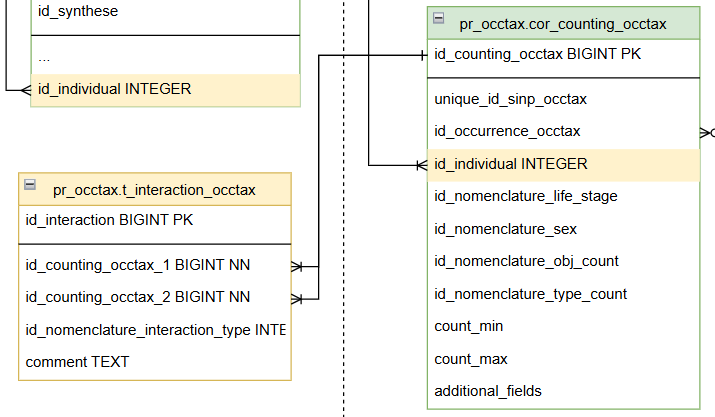

> [!CAUTION]
> Ne sera pas intégré au module individu : autre projet

Pour le suivi des populations, la notion d'interaction entre individus peut-être une niche d'informations. Dans notre contexte il s'agirait de qualifier l'interaction, lors d'une observation entre 2 occurences de taxon avec la possibilité de préciser l'individus concerné.

L'interaction peut aussi, par exemple, être intéressante à relever entre un invertébré et son hôte.

La notion d'interaction entre individus étant générique nous créons donc une table `pr_occtax.t_interaction_occtax` permettant de caractériser l'interaction entre 2 entrées de la table `pr_occtax.cor_counting_occtax`, c'est à dire entre 2 occurences (indépendament du taxon) d'un même relevé :

*Shéma de liaison entre les tables `pr_occtax.t_interaction_occtax` et `pr_occtax.cor_counting_occtax`* :

#### `pr_occtax.t_interaction_occtax`

Schéma : pr_occtax
Table : t_interaction_occtax

| Champ | Type | Contrainte | Détail |
| :---- | :---- | :---- | :---- |
| id_interaction | BIGINT | PK, NOT NULL | Identifiant unique de l'intéraction |
| id_counting_occtax_1 | BIGINT | FK, NOT NULL | Identifiant de la 1ère occurence concernée par l'interaction lié au champ `id_counting_occtax` de la table `cor_counting_occtax` |
| id_counting_occtax_2 | BIGINT | FK, NOT NULL | Identifiant de la 2nd occurence concernée par l'interaction lié au champ `id_counting_occtax` de la table `cor_counting_occtax` |
| id_nomenclature_interaction_type | INTEGER | FK, NOT NULL, CHECK | Identifiant du type d'intéraction lié au champ `id_nomenclature` de la table `ref_nomenclatures.t_nomenclatures` |